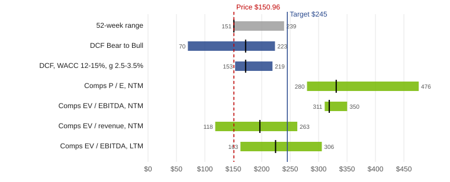
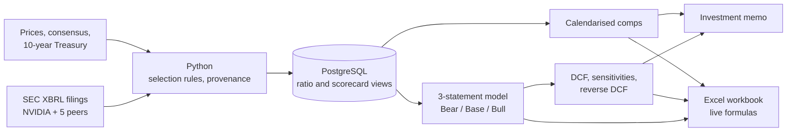

# NVIDIA (NVDA): Buy, 12-month target $260

**Question:** does NVIDIA's position in AI computing justify the future cash flows its share price implies?

**Answer:** on its own cash flows, only at a 12.05% discount rate (the model uses 13.87%). Against its peers, yes: NVIDIA
trades at 14.0× next-twelve-month earnings against a peer median of 26.1×, despite the group's highest growth (107%) and
gross margin (75%). Blending a DCF ($157.47) and comparable companies ($338.80) 50/50, with the DCF rolled forward a year,
gives a **12-month target of $260, +28.7% on $202.06 (2 Nov 2026 close): Buy**. The rating rests on relative value; the DCF
is the limit on how far it leans.

📄 **[Read the two-page investment memo (PDF)](docs/memo/NVDA_investment_memo.pdf)** · [Markdown version](docs/memo/NVDA_investment_memo.md)



| | Value per share | vs $202.06 |
|---|---:|---:|
| DCF, probability-weighted (Bear $66 / Base $168 / Bull $227) | $157.47 | −22% |
| Comps: peer-median NTM P/E and NTM EV/EBITDA | $338.80 | +68% |
| What the price implies | WACC 12.05%, or terminal growth 5.35%, or FY2028 Data Center growth 110% | |
| **12-month target** (50% DCF rolled forward + 50% comps) | **$260** | **+28.7%** |

## How it is built



| Step | What it produces | Where |
|---|---|---|
| 1–2 | SEC companyfacts for NVIDIA and peers (AMD, AVGO, MRVL, QCOM, INTC), prices, consensus, Treasury yield, with full provenance | `python/run_m1.py`, `python/fetch_step2.py` |
| 3 | Clean facts and LTM ratios in PostgreSQL; valuation at the cutoff | `sql/`, `python/run_step3.py` |
| 4 | 10-test quality scorecard, beta and WACC inputs (NVIDIA 18/20) | `config/scorecard.yaml`, `python/run_step4.py` |
| 5 | 3-statement forecast FY2027–FY2031, three scenarios, balance sheet balances every year | `excel/NVDA_Forecast.xlsx`, `python/step5_model.py` |
| 6 | DCF: Blume-adjusted beta, mid-year discounting, terminal value checks, WACC × growth and growth × margin sensitivities, reverse DCF | DCF tab, `python/step6_dcf.py` |
| 7 | Comparable companies on calendarised NTM and LTM multiples, football field, growth vs multiple | Comps tab, `python/step7_comps.py` |
| 9 | Two-page memo; every number in it generated from the outputs, with its source | `docs/memo/`, `python/step9_memo.py` |

A simpler Base-case workbook in a common template layout is in `excel/NVDA_Simple_DCF.xlsx`. The Power BI dashboard (Step 8)
is not built yet.

## How it is verified

- **180 values checked against the filings:** 15 NVIDIA (M1), 56 peer and 6 price (Step 2), 60 (Step 3), 37 (Step 5) and
  6 from the Q2 FY2027 10-Q (Step 6), each with accession number and location in `tests/fixtures/`.
- **Excel equals Python:** every workbook formula is recalculated and compared with an independent Python model for all six
  companies and three scenarios (worst difference below 1e-13).
- **137 offline tests and 20 reconciliation tests** (plus three workbook comparisons that need LibreOffice, done in Excel);
  outputs are byte-identical when rerun.
- **Every decision and every known issue is logged:** [`docs/decision_log.md`](docs/decision_log.md),
  [`docs/issue_log.md`](docs/issue_log.md). Each step was signed off against a checklist (`docs/m*_acceptance.md`), with
  its check report in `docs/evidence/`.

## Limitations

- Priced at the 2 Nov 2026 cutoff; NVIDIA's Q3 FY2027 results (17 Nov 2026) are the next update (I-69).
- The DCF has a five-year explicit period and 3% terminal growth; with these inputs every company in the group values
  below its price (I-60), which is why the rating rests on relative value. A longer fade period is planned (I-70).
- The peer median P/E is lifted by companies whose earnings are recovering (I-65); the memo states the full comps range
  ($222–$375).
- Peer forecasts are mechanical; NVIDIA's are researched (S5-D6).

This is a portfolio project, not investment advice.

## Setup (Windows, PowerShell)
Python 3.14.8 with a project venv outside OneDrive:
```powershell
$vpy = "$env:LOCALAPPDATA\venvs\nvda-stock-analysis\Scripts\python.exe"
& $vpy -m pip install -r requirements.txt
```

## Run
From the project folder:
```powershell
& $vpy -m pytest                                  # offline tests (synthetic snapshot, no network)
$env:SEC_USER_AGENT = "Your Name your-email@example.com"
& $vpy python\run_m1.py --source live             # fetch a new snapshot and process it
& $vpy python\run_m1.py --source snapshot         # reprocess the latest saved snapshot, offline
& $vpy -m pytest -m live                          # live SEC retrieval test
& $vpy -m pytest -m reconciliation                # compare output with tests\fixtures\reference_values.csv
& $vpy python\m1_check.py                         # every M1 check in one go -> data\clean\m1_check_report.txt

# Step 2
& $vpy python\fetch_step2.py                      # download everything into data\raw\collections\<id> (needs SEC_USER_AGENT)
& $vpy python\fetch_step2.py --add-rates <id>     # add the 10-year yield if FRED timed out
& $vpy python\run_step2.py                        # process the latest collection offline -> data\clean\step2
& $vpy python\m2_check.py                         # every Step 2 check in one go -> data\clean\step2\m2_check_report.txt

# Step 3 (PostgreSQL 13+; password only in the session, never in a file)
$env:PGPASSWORD = "<postgres password>"
& $vpy python\run_step3.py all                    # facts + database + exports -> data\clean\step3
& $vpy -m pytest -m db                            # database tests (rebuild the analytics schema)
& $vpy python\m3_check.py                         # every Step 3 check in one go -> data\clean\step3\m3_check_report.txt

# Step 4 (needs Step 3 built in the same database)
& $vpy python\fetch_step4.py                      # snapshot consensus estimates -> data\raw\estimates\<id> (network)
& $vpy python\run_step4.py all                    # estimates + beta, WACC, PEG and scorecard views -> data\clean\step4
& $vpy python\m4_check.py                         # every Step 4 check -> data\clean\step4\m4_check_report.txt

# Step 5 (offline; reads the Step 3 and Step 4 outputs)
& $vpy python\run_step5.py all                    # model line items, assumptions, forecast -> excel\NVDA_Forecast.xlsx
& $vpy python\m5_check.py                         # every Step 5 check -> data\clean\step5\m5_check_report.txt

# Step 6 (offline; reads the Step 3, 4 and 5 outputs)
& $vpy python\run_step6.py                        # DCF, sensitivities, reverse DCF -> data\clean\step6, WACC/DCF tabs in the workbook
& $vpy python\m6_check.py                         # every Step 6 check -> data\clean\step6\m6_check_report.txt

# Step 7 (offline; reads the Step 2-6 outputs)
& $vpy python\run_step7.py                        # comps, football field, DCF/comps blend -> data\clean\step7, Comps tab in the workbook
& $vpy python\m7_check.py                         # every Step 7 check -> data\clean\step7\m7_check_report.txt

# Step 9 (offline; reads the Step 4-7 outputs)
& $vpy python\run_step9.py                        # investment memo -> docs\memo\NVDA_investment_memo.md (+ exhibit, numbers file)
& $vpy python\m9_check.py                         # every Step 9 check -> data\clean\step9\m9_check_report.txt
& $vpy python\build_simple_dcf.py                 # optional: excel\NVDA_Simple_DCF.xlsx (Base case, simple template layout)
```
Change a forecast assumption in `config\model.yaml`, then `run_step5.py model`; edits made in the workbook itself are overwritten.

## Layout
| Path | Contents |
|---|---|
| `config/project.yaml` | Company, SEC settings, the 12 line items and their candidate XBRL concepts |
| `config/universe.yaml` | Step 2 companies, predecessors, fallbacks, derivations, market settings |
| `config/step5.yaml`, `config/manual_facts_step5.csv`, `config/model.yaml` | Step 5 model line items, NVIDIA Data Center revenue (manual from 10-K), forecast assumptions with reasons |
| `config/dcf.yaml` | Step 6 DCF settings: Blume beta, ERP, terminal growth, scenario weights, NVIDIA's listed equity stakes, sensitivity grids |
| `config/comps.yaml` | Step 7 comps settings: headline multiples, NTM calendarisation, exclusion rules, DCF/comps blend |
| `config/memo.yaml` | Step 9 memo settings: target and rating rules, guidance quoted, catalysts with sources |
| `config/scorecard.yaml` | Step 4 tests and thresholds, estimates source, WACC assumptions |
| `config/step3.yaml`, `config/manual_facts.csv`, `config/database.yaml` | Step 3 line items and derivations, manual facts (empty), PostgreSQL connection (no password) |
| `sql/` | `schema.sql`, `views.sql`, `checks.sql`, `queries/` |
| `python/` | M1: `fetch_sec.py`, `parse_companyfacts.py`, `select_facts.py`, `validate_m1.py`, `run_m1.py`, `m1_check.py`; Step 2: `fetch_step2.py`, `step2_sec.py`, `step2_market.py`, `run_step2.py`, `m2_check.py`; Step 3: `step3_facts.py`, `run_step3.py`, `step3_db.py`, `step3_reference.py`, `m3_check.py`; Step 4: `fetch_step4.py`, `step4_estimates.py`, `step4_db.py`, `step4_reference.py`, `run_step4.py`, `m4_check.py`; Step 5: `step5_facts.py`, `step5_model.py`, `build_model.py`, `step5_check.py`, `run_step5.py`, `m5_check.py`; Step 6: `step6_dcf.py`, `build_dcf.py`, `step6_check.py`, `run_step6.py`, `m6_check.py`; Step 7: `step7_comps.py`, `build_comps.py`, `step7_check.py`, `run_step7.py`, `m7_check.py`; Step 9: `step9_memo.py`, `run_step9.py`, `m9_check.py`, `build_simple_dcf.py` |
| `tests/` | Offline unit, contract and reproducibility tests; live and reconciliation tests on request |
| `data/raw/sec/` | M1 companyfacts snapshots and fetch manifest (not in Git) |
| `data/raw/collections/` | Step 2 collections, one dated folder per download run (not in Git) |
| `data/clean/` | Pipeline outputs (not in Git) |
| `excel/` | `NVDA_Model.xlsx` (Scorecard, Power Query), `NVDA_Forecast.xlsx` (3-statement model, DCF and comps, generated) |
| `docs/` | Decision log, issue log, M1–M7 and M9 acceptance, the investment memo (`docs/memo/`) checklists, data dictionary, evidence |

## Universe
Target NVDA. Peers AMD, AVGO, MRVL, QCOM, INTC. Benchmarks SPY, SOXX.
