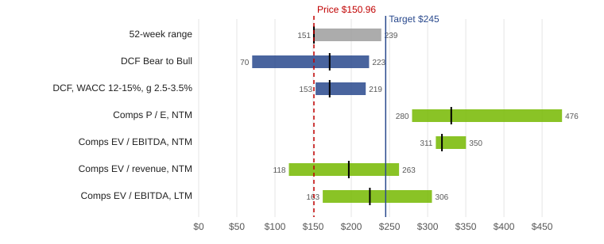

# NVIDIA (NVDA): Buy, 12-month target $260 (+28.7% vs $202.06 on 2 Nov 2026)

Kyan Soni · 9 Nov 2026 · Priced at the 2 Nov 2026 close; filings to the Q2 FY2027 10-Q; consensus fetched 3 Nov 2026. Every number below is computed by `python/step9_memo.py` from the project's Step 3–7 outputs (`data/clean/step9/memo_numbers.csv`).

**Question.** Does NVIDIA's position in AI computing justify the future cash flows its share price implies? **Answer:** on its own cash flows, only at a discount rate of 12.05% (we use 13.87%); relative to its peers, yes: comps value it at $339, +68% against the price. We rate it Buy on relative value, with the DCF as the limit on how far we lean.

## Thesis

1. **Data Center growth holds through FY2028.** Our Base case has Data Center revenue up 98% in FY2027 and 72% in FY2028, for total revenue of $411.6bn and $691.9bn, within 0.1% of consensus ($411.7bn, $692.2bn). *Test:* Q3 FY2027 revenue at or above the $108.0bn guidance on 17 Nov.
2. **Gross margin stays at or above 73% through FY2029 while Vera Rubin ramps.** Base gross margin is 74.5% in FY2027, easing to 73% by FY2029. Every 2 points lower in every year costs $5.90 a share; 4 points lower costs $11.80. *Test:* quarterly GAAP gross margin against the 74.0% guide.
3. **The discount to peers narrows.** NVIDIA trades at 14.0× NTM P/E and 11.5× NTM EV/EBITDA against peer medians of 26.1× and 17.4×, though its NTM revenue growth (107%) and gross margin (75%) are the highest of the six. *Test:* NVIDIA's NTM P/E as a share of the peer median, 54% today.

## What the market is pricing in (our variant view)

At $202.06, our Base-case DCF balances only if the discount rate is 12.05% instead of our 13.87%, or terminal growth is 5.3% instead of 3%, or FY2028 Data Center growth is 110% instead of 72%. Our WACC rests on a 60-month beta of 2.20 (Blume-adjusted 1.81), a measure of 2021–2026 volatility. The market prices NVIDIA's earnings as the least durable in the group: its NTM P/E of 14.0× is the lowest of the six. Our Base case already fades Data Center growth to 6% by FY2031, and a discount rate 1.8 points below ours is enough to support today's price on that fade. We think the market's discount is too wide; we do not think it is wrong by the full gap to peer multiples.

## Valuation

Target = 50% DCF + 50% comps. **DCF:** probability-weighted $157.47 (Bear $66.09 at 25%, Base $168.42 at 50%, Bull $226.92 at 25%; WACC 13.87%, terminal growth 3%), rolled forward 12 months at the cost of equity (13.95%) less the dividend yield (0.02%) to $179.39. **Comps:** $338.80, the mean of NVIDIA's value at the peer-median NTM P/E ($375) and NTM EV/EBITDA ($302); across NTM multiples the range is $222–$375, and on growth-adjusted EV/revenue $245. **Target** = 0.5 × 179.39 + 0.5 × 338.80 = $259.10, rounded to $260. Terminal value is 67% of Base EV, and the perpetuity implies 7.2× year-5 EV/EBITDA against 26.2× for peers today. The two methods point in opposite directions (DCF -22%, comps +68%); the rating rests on relative value.

**Scorecard:** 18/20, the highest of six (tied with QCOM), with near misses on trailing P/E (25.2× vs a 25× pass) and FCF conversion (81% vs 90%). Caveat: the scorecard measures business quality, not price; QCOM also scores 18 and its DCF shows -62%.

## Risks and what would change our mind

| Risk | What we watch | We would cut the rating if |
|---|---|---|
| AI capex slows | Data Center revenue each quarter; hyperscaler capex guidance | FY2028 revenue tracks the Bear case ($458bn vs Base $692bn; Bear value $66) |
| Custom chips at hyperscalers | Broadcom and Marvell AI revenue vs NVIDIA Data Center | NVIDIA's NTM revenue growth falls below Broadcom's (96% today vs NVIDIA 107%) |
| Memory costs and pricing | GAAP gross margin vs the 74.0% guide | Gross margin below 70% for two quarters (−4 points ≈ −$12 a share) |
| China export rules | China revenue disclosure; guidance exclusions | A guidance cut attributed to export rules |

## Catalysts

- **17 Nov 2026:** Q3 FY2027 results (conference call 2 p.m. PT).
- **Fall 2026:** Vera Rubin production shipments begin.
- **Late Jan to early Feb 2027 (expected):** Hyperscaler capex guidance with their Q4 calendar-2026 results.
- **Late Feb 2027 (expected):** Q4 FY2027 results and FY2028 outlook.

Rating rule: Buy above +15% 12-month expected total return, Sell below -10%, Hold between. This memo is analysis for a portfolio project, not investment advice.

## Exhibits

**Exhibit 1. Football field, USD per share** (price $202.06 marked)

**Exhibit 2. Valuation summary**

| Method | USD / share | vs price | Basis |
| --- | ---: | ---: | --- |
| DCF, Bear / Base / Bull | 66.09 / 168.42 / 226.92 |  | WACC 13.87%, g 3% |
| DCF, probability-weighted (25/50/25) | 157.47 | -22% | Step 6 |
| DCF, rolled forward 12 months | 179.39 | -11% | × (1 + 13.95% − 0.02%) |
| Comps: peer-median NTM P/E | 375.37 | +86% | 26.1× on NTM EPS |
| Comps: peer-median NTM EV/EBITDA | 302.23 | +50% | 17.4× via Step 6 bridge |
| Comps value (mean of the two) | 338.80 | +68% | S7-D1 |
| Growth-adjusted EV/revenue | 245.18 | +21% | indicative, 5 peers |
| **Target (50% DCF fwd + 50% comps)** | **260.00** | **+28.7%** | from 259.10, rounded |

**Exhibit 3. Base-case DCF value per share: WACC (rows) × terminal growth (columns).** Bold: the cell closest to the price.

| WACC \ g | 2.0% | 2.5% | 3.0% | 3.5% | 4.0% |
| --- | ---: | ---: | ---: | ---: | ---: |
| 10% | 234 | 247 | 261 | 277 | 296 |
| 11% | 208 | 218 | 228 | 240 | 254 |
| 12% | 188 | 195 | **203** | 212 | 223 |
| 13% | 171 | 176 | 183 | 190 | 198 |
| 14% | 156 | 161 | 167 | 172 | 179 |
| 15% | 145 | 149 | 153 | 158 | 163 |
| 16% | 134 | 138 | 141 | 145 | 149 |

**Exhibit 4. Peers on NTM figures (calendarised to Nov 2026–Oct 2027)**

|  | NTM revenue growth | Gross margin (LTM) | EV / revenue | EV / EBITDA | P / E |
| --- | ---: | ---: | ---: | ---: | ---: |
| **NVDA** | 107% | 75% | 7.7× | 11.5× | 14.0× |
| AMD | 104% | 53% | 8.9× | n/m† | 31.5× |
| AVGO | 96% | 69% | 9.0× | 15.6× | 16.6× |
| INTC | 14% | 40% | 4.6× | 19.2× | 34.2× |
| MRVL | 89% | 52% | 8.5× | 28.4× | 26.1× |
| QCOM | 2% | 54% | 4.0× | 14.8× | 16.0× |
| Peer median |  |  | 8.5× | 17.4× | 26.1× |

† AMD: no EBITDA multiple (fiscal-year EBITDA basis, S3-D11). NTM EBITDA = NTM revenue × LTM EBITDA margin (S7-D4).

**Exhibit 5. Scenarios**

| Scenario | Weight | FY2028 revenue ($bn) | FY2028 Data Center growth | FY2028 gross margin | FY2028 EPS | DCF value | vs price |
| --- | ---: | ---: | ---: | ---: | ---: | ---: | ---: |
| Bear | 25% | 458 | 20% | 71.0% | 9.58 | 66.09 | -67% |
| Base | 50% | 692 | 72% | 74.0% | 15.88 | 168.42 | -17% |
| Bull | 25% | 757 | 85% | 75.0% | 18.08 | 226.92 | +12% |

Sources: SEC 10-K and 10-Q filings (XBRL companyfacts, checked against the filings); Yahoo Finance consensus via yfinance, cross-checked with Nasdaq; daily prices to the cutoff; project decision log S3–S9 and issue log I-58 to I-70.
