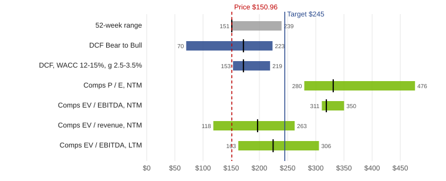

# NVIDIA (NVDA): {rating}, 12-month target ${target:,.0f} ({exp_return:+.1%} vs ${price:.2f} on {price_date_long})

{author} · {memo_date_long} · Priced at the {price_date_long} close; filings to the Q2 FY2027 10-Q; consensus fetched {consensus_date_long}. Every number below is computed by `python/step9_memo.py` from the project's Step 3–7 outputs (`data/clean/step9/memo_numbers.csv`).

**Question.** Does NVIDIA's position in AI computing justify the future cash flows its share price implies? **Answer:** on its own cash flows, only at a discount rate of {rev_wacc:.2%} (we use {wacc:.2%}); relative to its peers, yes: comps value it at ${comps:.0f}, {comps_up:+.0%} against the price. We rate it {rating} on relative value, with the DCF as the limit on how far we lean.

## Thesis

1. **Data Center growth holds through FY2028.** Our Base case has Data Center revenue up {dc_g1:.0%} in FY2027 and {dc_g2:.0%} in FY2028, for total revenue of ${rev_fy27_bn:,.1f}bn and ${rev_fy28_bn:,.1f}bn, within {cons_gap_max:.1%} of consensus (${cons_fy27_bn:,.1f}bn, ${cons_fy28_bn:,.1f}bn). *Test:* Q3 FY2027 revenue at or above the ${guide_rev_bn:.1f}bn guidance on 17 Nov.
2. **Gross margin stays at or above {gm_floor:.0%} through FY2029 while Vera Rubin ramps.** Base gross margin is {gm_fy27:.1%} in FY2027, easing to {gm_fy29:.0%} by FY2029. Every 2 points lower in every year costs ${gm2_cost:.2f} a share; 4 points lower costs ${gm4_cost:.2f}. *Test:* quarterly GAAP gross margin against the {guide_gm:.1%} guide.
3. **The discount to peers narrows.** NVIDIA trades at {nv_pe:.1f}× NTM P/E and {nv_eve:.1f}× NTM EV/EBITDA against peer medians of {med_pe:.1f}× and {med_eve:.1f}×, though its NTM revenue growth ({nv_growth:.0%}) and gross margin ({nv_gm:.0%}) are the highest of the six. *Test:* NVIDIA's NTM P/E as a share of the peer median, {pe_rel:.0%} today.

## What the market is pricing in (our variant view)

At ${price:.2f}, our Base-case DCF balances only if the discount rate is {rev_wacc:.2%} instead of our {wacc:.2%}, or terminal growth is {rev_g:.1%} instead of {g:.0%}, or FY2028 Data Center growth is {rev_dc:.0%} instead of {dc_g2:.0%}. Our WACC rests on a 60-month beta of {beta_raw:.2f} (Blume-adjusted {beta_adj:.2f}), a measure of 2021–2026 volatility. The market prices NVIDIA's earnings as the least durable in the group: its NTM P/E of {nv_pe:.1f}× is the lowest of the six. Our Base case already fades Data Center growth to {dc_g5:.0%} by FY2031, and a discount rate {wacc_gap_pt:.1f} points below ours is enough to support today's price on that fade. We think the market's discount is too wide; we do not think it is wrong by the full gap to peer multiples.

## Valuation

Target = {w_dcf:.0%} DCF + {w_comps:.0%} comps. **DCF:** probability-weighted ${dcf_w:.2f} (Bear ${bear:.2f} at 25%, Base ${base:.2f} at 50%, Bull ${bull:.2f} at 25%; WACC {wacc:.2%}, terminal growth {g:.0%}), rolled forward 12 months at the cost of equity ({ke:.2%}) less the dividend yield ({div_yield:.2%}) to ${dcf_fwd:.2f}. **Comps:** ${comps:.2f}, the mean of NVIDIA's value at the peer-median NTM P/E (${imp_pe:.0f}) and NTM EV/EBITDA (${imp_eve:.0f}); across NTM multiples the range is ${comps_lo:.0f}–${comps_hi:.0f}, and on growth-adjusted EV/revenue ${reg_price:.0f}. **Target** = {w_dcf:.1f} × {dcf_fwd:.2f} + {w_comps:.1f} × {comps:.2f} = ${target_raw:.2f}, rounded to ${target:,.0f}. Terminal value is {tv_share:.0%} of Base EV, and the perpetuity implies {impl_x:.1f}× year-5 EV/EBITDA against {ltm_eve_med:.1f}× for peers today. The two methods point in opposite directions (DCF {dcf_up:+.0%}, comps {comps_up:+.0%}); the rating rests on relative value.

**Scorecard:** {nv_score}/{score_max}, the highest of six (tied with QCOM), with near misses on trailing P/E ({sc_pe:.1f}× vs a {sc_pe_pass:.0f}× pass) and FCF conversion ({sc_fcf:.0%} vs {sc_fcf_pass:.0%}). Caveat: the scorecard measures business quality, not price; QCOM also scores {qcom_score} and its DCF shows {qcom_up:+.0%}.

## Risks and what would change our mind

| Risk | What we watch | We would cut the rating if |
|---|---|---|
| AI capex slows | Data Center revenue each quarter; hyperscaler capex guidance | FY2028 revenue tracks the Bear case (${bear_rev28_bn:,.0f}bn vs Base ${rev_fy28_bn:,.0f}bn; Bear value ${bear:.0f}) |
| Custom chips at hyperscalers | Broadcom and Marvell AI revenue vs NVIDIA Data Center | NVIDIA's NTM revenue growth falls below Broadcom's ({avgo_growth:.0%} today vs NVIDIA {nv_growth:.0%}) |
| Memory costs and pricing | GAAP gross margin vs the {guide_gm:.1%} guide | Gross margin below {gm_floor_cut:.0%} for two quarters (−4 points ≈ −${gm4_cost:.0f} a share) |
| China export rules | China revenue disclosure; guidance exclusions | A guidance cut attributed to export rules |

## Catalysts

{catalysts}

Rating rule: Buy above {buy_above:+.0%} 12-month expected total return, Sell below {sell_below:+.0%}, Hold between. This memo is analysis for a portfolio project, not investment advice.

## Exhibits

**Exhibit 1. Football field, USD per share** (price ${price:.2f} marked)

**Exhibit 2. Valuation summary**

{ex_valuation}

**Exhibit 3. Base-case DCF value per share: WACC (rows) × terminal growth (columns).** Bold: the cell closest to the price.

{ex_grid}

**Exhibit 4. Peers on NTM figures (calendarised to Nov 2026–Oct 2027)**

{ex_comps}

**Exhibit 5. Scenarios**

{ex_scen}

Sources: SEC 10-K and 10-Q filings (XBRL companyfacts, checked against the filings); Yahoo Finance consensus via yfinance, cross-checked with Nasdaq; daily prices to the cutoff; project decision log S3–S9 and issue log I-58 to I-70.
