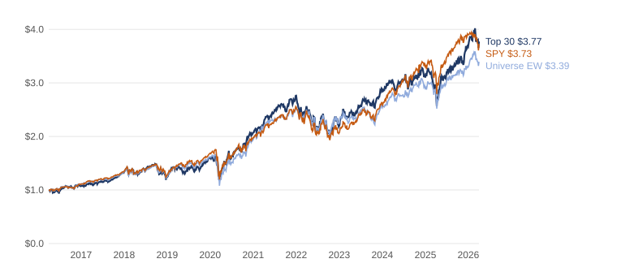

# Does quality pay? An S&P 500 screen, 2016–2026

Version 2 of the NVIDIA project · 2026-11-18 · every number below is read from `data/clean/v2` by `python/run_v2_report.py`.

**Question.** Do companies that score well on the project's quality scorecard (Step 4, filing-based version) beat the S&P 500 over the next year?
**Answer: Partly: the screen beat the companies it could rank, but only matched the S&P 500.** Buying the top 30 each 1 April from 2016-04-01 to 2026-04-01 returned **14.20% a year** after 0.1% costs a side,
against **14.06%** for SPY and **13.00%** for an equal-weight portfolio of every company the screen could rank. It beat SPY in
5 of 10 years and the equal-weight universe in 5 of 10. Random 30-stock portfolios from the same companies: the screen beat 79% of random portfolios; 5th-95th percentile 9.60% to 15.78%.

| Series | CAGR | Volatility | Sharpe (rf 0) | Max drawdown | Information ratio vs SPY |
|---|---|---|---|---|---|
| Top 30 (net) | 14.20% | 19.9% | 0.77 | -29.0% | 0.07 |
| Equal-weight ranked universe | 13.00% | 18.2% | 0.77 | -37.1% | -0.15 |
| SPY | 14.06% | 17.9% | 0.83 | -33.7% | – |

**Year by year** (holding period starting each April)

| Start | Top 30 | Universe | SPY | vs SPY |
|---|---|---|---|---|
| 2016-04 | +11.2% | +15.7% | +16.1% | -4.9% |
| 2017-04 | +16.8% | +11.1% | +11.5% | +5.3% |
| 2018-04 | +9.0% | +13.0% | +13.2% | -4.1% |
| 2019-04 | -10.6% | -19.5% | -12.1% | +1.5% |
| 2020-04 | +80.0% | +87.1% | +65.4% | +14.6% |
| 2021-04 | +11.0% | +12.7% | +14.5% | -3.5% |
| 2022-04 | -1.8% | -3.7% | -7.7% | +5.9% |
| 2023-04 | +23.3% | +18.3% | +28.9% | -5.6% |
| 2024-04 | -4.8% | +1.5% | +8.8% | -13.6% |
| 2025-04 | +29.5% | +19.0% | +18.1% | +11.3% |

## How robust is it?

| Variant (one change at a time) | CAGR | vs SPY |
|---|---|---|
| Main: top 30, 1 April, 0.1% a side | 14.20% | +0.14% |
| Top 20 | 12.88% | -1.19% |
| Top 50 | 15.35% | +1.29% |
| No trading costs | 14.32% | +0.26% |
| Today's members only (survivorship-biased) | 16.39% | +2.33% |
| Equal-weight all ranked (universe benchmark) | 13.00% | -1.07% |
| 1 July rebalance (2016-07 to 2026-07) | 16.17% | +0.82% |
| Random 30-stock portfolios: median of 1000 | 12.73% | -1.33% |

Read the "today's members only" line as a warning, not a result: testing only companies still in the index
changes the result by +2.19% a year, the effect of the survivorship bias the point-in-time universe removes.

## Today's screen

NVIDIA scores 16.0/18 today and ranks 7 of 359. Top ten (full list in `excel/SP500_Screener.xlsx`):

| Rank | Ticker | Company | Sector | Points | ROIC |
|---|---|---|---|---|---|
| 1 | DECK | Deckers Brands | Consumer Discretionary | 18.0/18 (9 tests) | 164% |
| 2 | INCY | Incyte | Health Care | 18.0/18 (8 tests) | 61% |
| 3 | CF | CF Industries | Materials | 18.0/18 (9 tests) | 30% |
| 4 | RL | Ralph Lauren Corporation | Consumer Discretionary | 17.0/18 (8 tests) | 51% |
| 5 | MNST | Monster Beverage | Consumer Staples | 17.0/18 (8 tests) | 36% |
| 6 | EOG | EOG Resources | Energy | 16.5/18 (8 tests) | 16% |
| 7 | NVDA | Nvidia | Information Technology | 16.0/18 (9 tests) | 138% |
| 8 | TPR | Tapestry, Inc. | Consumer Discretionary | 16.0/18 (9 tests) | 77% |
| 9 | ADBE | Adobe Inc. | Information Technology | 16.0/18 (9 tests) | 66% |
| 10 | ULTA | Ulta Beauty | Consumer Discretionary | 16.0/18 (9 tests) | 56% |

## Method and limits

- **Universe (V2-D1).** Members at each date rebuilt from Wikipedia's dated change history; each member's SEC filer at that date is the one that filed an annual report in the prior 18 months (V2-D9). Financials and Real Estate excluded (V2-D2).
- **No look-ahead (V2-D12).** Only annual-report facts filed before the date; latest fiscal year; Version 1's formulas. 46/48 metric values for the six Version 1 companies agree with Version 1 within 0.5 points.
- **Scorecard (V2-D3, V2-D13).** Nine of Step 4's ten tests (PEG needs consensus history that free sources do not keep); ROIC against a fixed 15% hurdle; gross margin against the sector median; at least 7 tests to be ranked; a test a company cannot be scored on (an insurer's quick ratio, ROE on negative equity) takes its sector's median points, so data gaps neither help nor hurt.
- **Survivorship (I-80).** Yahoo has no prices for most companies taken over or delisted, so they cannot be held: usable prices for 78%–99% of eligible members across April dates. The equal-weight universe has the same limit, so the screen-versus-universe gap is the cleaner measure of the scorecard's effect.
- **Sectors of former members** come from SEC SIC codes mapped to GICS (V2-D11); current members use Wikipedia's GICS.
- Holdings whose prices stop are held at their last price to the next rebalance (V2-D16). Costs 0.1% a side on traded weight.

Analysis for a portfolio project, not investment advice. Decisions V2-D1 to V2-D16: `docs/decision_log.md`; issues I-72 onwards: `docs/issue_log.md`.
